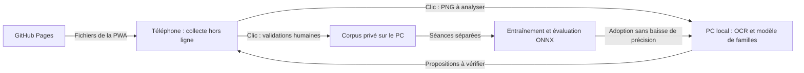

# Scan Tableau

PWA d'analyse et de validation de photos de tableaux électriques pour le CFA et le CAP Électricien. Le travail de base s'effectue sur le téléphone, sans PC et hors ligne après le chargement initial.

Application : **https://michto-p.github.io/scanTab/**. Sources : **https://github.com/Michto-p/scanTab**.

Les consignes de travail sont dans [AGENTS.md](AGENTS.md), et le suivi dans [PROGRESSION.md](PROGRESSION.md).

## État du projet

Le parcours de collecte est utilisable : import et entrée caméra native, cadrage, redressement, proposition de rangées, correction au demi-module, vignettes PNG, étiquettes humaines, stockage local et export ZIP par séance.

La capture ou l'import lance le cadrage, le redressement et les propositions de contours. **La lecture attend la sélection de l'utilisateur** : toucher les appareils voulus, ou encadrer une rangée et renseigner sa largeur totale en modules, puis choisir **Découper et lire**. Les appareils d'un ou plusieurs modules sont séparés selon les joints visibles, pas tous les 18 mm par défaut. Les données illisibles restent inconnues et aucune proposition n'est validée automatiquement. La galerie accepte plusieurs photos, préparées successivement et conservées dans une même séance.

L'écran principal contient la photo et le panneau de sélection/lecture. **Mes photos et options** regroupe les photos sauvegardées, les séances, l'export, les corrections avancées et le PC. Le type lu est affiché directement ; **Corriger le type** ouvre un choix seulement si nécessaire. Un disjoncteur simple présente calibre, courbe et pôles, sans champs de sensibilité ou de classe différentielle.

Le PC est un complément facultatif pour collecter les validations et entraîner un futur classifieur de familles. **Aucun réseau de familles électriques n'est livré** ; le téléphone utilise d'abord des règles transparentes, de provenance `regles_ocr`. Une photo publique réelle complète les essais synthétiques ; la précision sur un corpus varié et la recette terrain Android/iOS restent ouvertes. Aucun contrôle réglementaire n'est intégré.

L'utilisateur a confirmé que son message initial fait foi pour la phase 1. Il est conservé dans [CAHIER_DES_CHARGES.md](CAHIER_DES_CHARGES.md).

## Organisation

- `app/` : application PWA, capture, traitement, segmentation, identification, apprentissage, base locale, interface, exports et règles.
- `shared/` : réservé aux modules Electracé ; lecture seule par défaut, aucune modification sans accord explicite.
- `models/` : emplacement réservé aux futurs modèles publics pour le téléphone.
- `training/` : serveur PC, OCR local, préparation du corpus, moteur Python et export ONNX.
- `tests/photos/` : dessins synthétiques annotés, marquages OCR et photo publique de régression avec attribution ; corpus métier réel encore à collecter.

Attendre **Disponible hors ligne** au premier chargement : environ **17,14 Mo** de scripts, moteurs WASM et langues français/anglais sont servis par le même site et précachés. La lecture des appareils fonctionne ensuite sans Internet ni PC. Aucun CDN à l'exécution ni API d'IA distante. Les photos quittent le navigateur uniquement par export ou action explicite d'envoi au PC.

## Analyse sur le téléphone

1. Prendre une ou plusieurs photos nettes, aussi frontales que possible. **Importer des photos** permet de sélectionner un lot ; les photos enregistrées restent accessibles séparément dans la même séance. Une photo illisible est signalée et n'efface pas les autres. L'arrêt interrompt aussi les photos restantes du lot.
2. Laisser le cadrage automatique se terminer. Si ses indices sont insuffisants, l'image entière reste disponible. **Corriger le cadrage** permet de déplacer les quatre coins ; les corrections humaines restent prioritaires. L'option **Cadrer et repérer après la photo**, dans le menu, permet de désactiver cette préparation automatique.
3. Toucher seulement les appareils à lire, ou choisir **Encadrer une rangée** et faire glisser le doigt autour d'une seule rangée. La vue se rapproche de la zone choisie sans modifier les pixels conservés. Renseigner **Modules dans cette zone** : par exemple 13 modules au total, et non 13 appareils. **Vérifier les séparations** affiche les propositions avant lecture ; **Découper et lire** les calcule puis lance directement l'OCR sur les découpes sélectionnées. Les joints masqués peuvent rester fusionnés ; les réglages de séparations sont accessibles sous le panneau. Une zone sans échelle peut être lue, mais sa largeur doit être confirmée avant validation.
4. Vérifier les données correspondant au type détecté, les corriger puis valider. Changer explicitement le type retire les caractéristiques devenues incompatibles. Si d'anciennes valeurs cachées contredisent le type, la validation est bloquée jusqu'à sa confirmation ou sa correction. Les outils de relecture et le texte brut sont dans **Lecture, origine des données et outils**. **Sélectionner d'autres appareils** conserve les lectures précédentes et permet d'ajouter une autre zone de la même photo. **Arrêter l'analyse** garde les lectures terminées.

Un fond homogène distinct de la façade peut être retiré automatiquement. L'aperçu affiche alors le PNG transparent, avec **Voir l'original** pour comparer et **Télécharger ce PNG à fond transparent** pour l'enregistrer. Le masque reste une proposition géométrique : un contour touchant le cadre, un fond variable ou trop proche de la façade laisse la vignette intacte avec une explication. Les dimensions et les inscriptions internes sont conservées. **L'OCR et le ZIP d'apprentissage utilisent toujours la vignette originale**, conservée séparément du détourage.

La largeur physique proposée est le nombre de modules × 18 mm. Cette conversion suppose que l'échelle géométrique ou le repère est correct ; les 18 mm seuls ne déterminent pas des pixels sur une photo. Une façade uniforme, des séparations masquées ou une photo oblique peuvent nécessiter un repère manuel. Le détecteur ne localise pas un rail DIN caché.

Les formats courants (disjoncteur d'un module, différentiel de deux modules, prise de 2,5 modules) sont des exemples, pas des règles de classification. Le catalogue local contient actuellement seulement trois références exactes de prises Legrand : `004280`, `004283` et `092782`, avec leurs sources officielles dans `app/identification/catalogue.js`. Une marque Legrand lisible et une référence exacte sont nécessaires ; aucun accès au catalogue en ligne n'a lieu pendant l'analyse. Une largeur contredisant le marquage ou la référence produit un avertissement sans déplacer les bords. Les appareils d'un autre format restent inconnus si les indices manquent.

Les références déjà validées sur cet appareil complètent le catalogue : une marque et une référence OCR exactes peuvent retrouver leurs attributs, avec provenance `base_validee` et identifiants des validations sources. Deux validations contradictoires, un marquage incompatible ou une ancienne simple prédiction empêchent ce rapprochement. Cela n'entraîne aucun modèle et ne valide pas la nouvelle lecture.

La photo publique de recette montre deux rangées devant un coffret voisin contrasté. Le test géométrique retrouve 20 façades par bande, couvrant environ 99 % et 90 % des bandes annotées ; cela ne mesure ni le rappel de tous les appareils ni leur identification. La sélection d'une zone et d'un total modulaire apporte un repère lorsque la recherche globale échoue, mais des joints faibles restent fusionnés. Sans cadrage, des zones de coffret sont aussi proposées. La faible définition de cette photo ne permet pas de certifier ses références. Une détection fiable sur toute photo reste hors de portée de cette heuristique.

Une lecture `C16` suggère provisoirement un disjoncteur ; elle n'exclut pas une fonction différentielle non lue. `30 mA` et TEST seuls ne distinguent pas interrupteur et disjoncteur différentiels. Un pictogramme différentiel sans texte ni référence reconnue reste inconnu. Les scores OCR et de règles ne sont pas des probabilités calibrées.

## PC facultatif pour l'apprentissage

Le moteur est installé dans `.local/` sur ce poste. Ouvrir **`Demarrer-PC.cmd`**, garder son terminal ouvert et recopier l'adresse réseau et le code dans le panneau PC de l'application. Téléphone et PC doivent être sur le même réseau Wi-Fi. L'application ne recherche aucun appareil automatiquement.

Sur un nouveau poste, ouvrir d'abord **`Installer-moteur.cmd`** (connexion Internet nécessaire uniquement pour les téléchargements initiaux). Le [guide du moteur](training/README.md) détaille l'installation, les certificats, le corpus, l'apprentissage et les limites.



## Lancement local

Les fichiers nécessaires au téléphone sont déjà dans `app/`, sans installation ni compilation. Node.js 24 ou récent suffit pour les servir localement :

```sh
node scripts/serve.mjs
```

Ouvrir `http://localhost:8080/app/`. Attendre la mention « Disponible hors ligne » avant de couper la connexion. Un fichier ouvert directement par `file://` ne permet pas le service worker.

```sh
node --test tests/*.test.mjs
node tests/run-browser.mjs
node tests/run-browser.mjs --mobile-ocr
```

La recette navigateur utilise Chrome installé sur Windows ; `CHROME_PATH` permet de désigner un autre exécutable Chromium. Pour un téléphone, servir les fichiers de `app/` en HTTPS : une adresse HTTP du PC sur le réseau local ne suffit pas pour la caméra et le service worker.

## Parcours de collecte

1. Pour le parcours manuel ci-dessous, décocher **Analyser automatiquement après la photo**. Prendre une photo avec la caméra native du téléphone ou importer une image. Le fichier original est conservé, sans réduction de résolution. Un format illisible est signalé ; JPEG et PNG sont les formats conseillés pour les essais.
2. Ouvrir « Informations de séance et de validation » pour nommer le tableau et confirmer l'identifiant de séance. Toutes les photos d'une même prise de vue doivent garder cet identifiant ; « Nouvelle séance » en crée un autre.
3. Dans « Redresser », déplacer les quatre coins ou renseigner leurs positions en pourcentage. Appliquer le redressement ; le traitement utilise l'image originale, pas la miniature d'affichage.
4. Dans « Découper », proposer ou ajouter les rangées. Ajuster leurs limites et confirmer l'estimation ou le repère de l'échelle. Une bande détectée par seul contraste reste non calibrée. Un module vaut 18 mm ; aucun nombre de modules n'est imposé.
5. Ajuster les séparations par demi-module : toucher l'intérieur d'une rangée, ou saisir les positions séparées par des points-virgules (`1; 2; 4; 6.5`). Retirer une séparation réunit les appareils larges. Créer les vignettes.
6. Utiliser **Découper et lire sur cet appareil** ou **Lire cette vignette**, vérifier les propositions, corriger les marquages et renseigner le validateur, puis valider. Une famille identifiable est nécessaire ; les autres champs peuvent rester « inconnu ». Toute correction retire la validation.
7. Exporter la séance en ZIP. Les photos enregistrées portant le même identifiant sont regroupées ; seules leurs vignettes validées sont incluses. Un cadrage modifié doit être appliqué avant l'export.

Les photos enregistrées se rouvrent dans la liste, y compris après redémarrage hors ligne. Une sauvegarde automatique confirme « Enregistré sur cet appareil ». Le stockage appartient au profil du navigateur ; conserver les ZIP pour les transferts sur PC et avant d'effacer les données du navigateur.

## Format du ZIP

ZIP standard sans compression (les PNG sont déjà compressés), avec noms UTF-8 et CRC-32, sans bibliothèque supplémentaire :

```text
vignettes/<id>.png
labels.json
```

`labels.json` contient un tableau d'appareils. Chaque entrée porte `id`, `famille`, `marque`, `référence`, `calibre`, `courbe`, `sensibilité`, `classe`, `pôles`, `modules`, `séance`, `date` et `validé_par`.

Chaque caractéristique est un objet `{ "valeur": ..., "confiance": ..., "niveau": "manuel" }`. Le calibre est saisi en A et la sensibilité en mA ; la largeur numérique est arrondie au demi-module. Une valeur inconnue conserve une confiance de 0. Après validation, la confiance de 1 atteste une confirmation humaine et ne représente pas une probabilité calculée par un modèle.

`séance` est l'identifiant commun à la prise de vue, distinct de l'identifiant de chaque photo conservée localement. `date` est la date ISO de validation humaine. Les photos originales ne sont pas incluses dans le ZIP. La séparation des données d'entraînement utilise `séance`.

## Vérification et limites

Les tests couvrent les quadrilatères invalides, le cadrage frontal et oblique, le redressement des pixels, les demi-modules, les bandes des dessins annotés, le détourage et ses refus prudents, la validation, l'exclusion des appareils non validés et le format ZIP. La recette Chrome vérifie aussi les pixels, IndexedDB, les corrections dans l'interface, un export regroupant deux photos, la restauration et le rechargement sans réseau ni cache HTTP. Elle teste le vrai worker, l'import automatique, l'arrêt pendant le cadrage et l'OCR, la comparaison original/détourage et le PNG réellement téléchargé.

Les dessins de `tests/photos` ne sont pas des photos réelles. La proposition utilise les bords et le contraste ; elle ne garantit ni la localisation des rails DIN ni la détection sur n'importe quelle photo. Un appareil masqué, flou, coupé ou sans contour distinct peut ne pas être trouvé ; les limites restent corrigeables manuellement. La netteté estimée ne garantit pas la lisibilité d'un marquage. Les grandes images peuvent atteindre les limites mémoire du téléphone ; aucune réduction silencieuse de résolution n'est appliquée.

La caméra physique, l'orientation des photos de téléphone, Safari iOS, Chrome Android, la liaison PC depuis le téléphone et l'objectif de moins de 5 secondes par rangée réelle de 13 modules restent à essayer. Sur le dessin annoté de 8 modules et 6 appareils, le parcours complet prend environ 1,3 à 2 s sur ce PC ; cela ne préjuge pas du téléphone ni de photos réelles. La recette coupe réseau et cache HTTP, ferme réellement les serveurs web et PC, recharge la PWA puis exécute OCR et parcours automatique. Elle vérifie aussi les valeurs inconnues sur blanc et l'absence de validation automatique.

## Ressources OCR embarquées

`app/vendor/ocr/` contient Tesseract.js 7.0.0, son worker, les trois variantes LSTM WASM (sans SIMD, SIMD et relaxed-SIMD) et les modèles rapides `eng`/`fra`. Les licences et `version.json` avec SHA-256 sont inclus. Pour reproduire la copie : installer l'OCR PC avec `training/installer-ocr.ps1` puis exécuter `npm run prepare:ocr`. Ce script copie des distributions existantes ; il n'ajoute pas d'étape de compilation. Les tests vérifient les empreintes et une taille totale inférieure à 30 Mo.

## Publication

Le workflow `.github/workflows/pages.yml` publie uniquement `app/`, sans compilation, sur chaque modification de l'application dans `main` ou `master`. Les sources Python sont dans le dépôt, mais le serveur, `.local/`, les photos privées et les codes d'appairage ne sont pas hébergés par Pages. Aucun envoi du corpus ou d'un modèle entraîné vers GitHub n'est automatique.

Si l'application était déjà ouverte avant une mise à jour, attendre « Mise à jour prête », fermer ses onglets/fenêtres puis la rouvrir avec une connexion. Attendre ensuite « Disponible hors ligne » pour vérifier que les ressources OCR sont installées ; ne pas effacer les données du navigateur pour mettre à jour.
