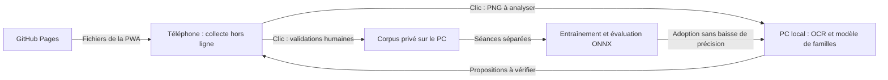

# Scan Tableau

PWA de collecte et de validation de photos de tableaux électriques pour le CFA et le CAP Électricien, avec OCR et apprentissage sur un PC du réseau local.

Application : **https://michto-p.github.io/scanTab/**. Sources : **https://github.com/Michto-p/scanTab**.

Les consignes de travail sont dans [AGENTS.md](AGENTS.md), et le suivi dans [PROGRESSION.md](PROGRESSION.md).

## État du projet

Le parcours de collecte est utilisable : import et entrée caméra native, cadrage, redressement, proposition de rangées, correction au demi-module, vignettes PNG, étiquettes humaines, stockage local et export ZIP par séance.

Le serveur PC propose les marquages avec Tesseract.js local et peut entraîner un classifieur de familles avec Python/PyTorch, puis exécuter son export ONNX. **Aucun modèle de familles électriques n'est livré** : il faut collecter plusieurs séances validées avant de l'entraîner. Les propositions ne sont jamais validées automatiquement. Le repérage des rails DIN sur photos réelles, la recette sur téléphones et l'inférence de familles embarquée restent ouverts ; voir `PROGRESSION.md`. Aucun contrôle réglementaire n'est intégré.

L'utilisateur a confirmé que son message initial fait foi pour la phase 1. Il est conservé dans [CAHIER_DES_CHARGES.md](CAHIER_DES_CHARGES.md).

## Organisation

- `app/` : application PWA, capture, traitement, segmentation, identification, apprentissage, base locale, interface, exports et règles.
- `shared/` : réservé aux modules Electracé ; lecture seule par défaut, aucune modification sans accord explicite.
- `models/` : emplacement réservé aux futurs modèles publics pour le téléphone.
- `training/` : serveur PC, OCR local, préparation du corpus, moteur Python et export ONNX.
- `tests/photos/` : dessins synthétiques annotés et marquages OCR ; corpus réel encore à collecter.

L'application de collecte fonctionne hors ligne une fois la mention « Disponible hors ligne » affichée. Aucun CDN à l'exécution ni API d'IA distante. Les photos quittent le navigateur uniquement par export ou action d'envoi au PC. L'analyse PC nécessite sa connexion locale ; sans PC, la collecte manuelle reste disponible.

## Utiliser le PC

Le moteur est installé dans `.local/` sur ce poste. Ouvrir **`Demarrer-PC.cmd`**, garder son terminal ouvert et recopier l'adresse réseau et le code dans le panneau PC de l'application. Téléphone et PC doivent être sur le même réseau Wi-Fi. L'application ne recherche aucun appareil automatiquement.

Sur un nouveau poste, ouvrir d'abord **`Installer-moteur.cmd`** (connexion Internet nécessaire uniquement pour les téléchargements initiaux). Le [guide du moteur](training/README.md) détaille l'installation, les certificats, le corpus, l'apprentissage et les limites.



## Lancement local

Node.js 24 ou récent suffit pour la collecte seule, sans installation de bibliothèque :

```sh
node scripts/serve.mjs
```

Ouvrir `http://localhost:8080/app/`. Attendre la mention « Disponible hors ligne » avant de couper la connexion. Un fichier ouvert directement par `file://` ne permet pas le service worker.

```sh
node --test tests/*.test.mjs
node tests/run-browser.mjs
```

La recette navigateur utilise Chrome installé sur Windows ; `CHROME_PATH` permet de désigner un autre exécutable Chromium. Pour un téléphone, servir les fichiers de `app/` en HTTPS : une adresse HTTP du PC sur le réseau local ne suffit pas pour la caméra et le service worker.

## Parcours de collecte

1. Prendre une photo avec la caméra native du téléphone ou importer une image. Le fichier original est conservé, sans réduction de résolution. Un format illisible est signalé ; JPEG et PNG sont les formats conseillés pour les essais.
2. Ouvrir « Informations de séance et de validation » pour nommer le tableau et confirmer l'identifiant de séance. Toutes les photos d'une même prise de vue doivent garder cet identifiant ; « Nouvelle séance » en crée un autre.
3. Dans « Redresser », déplacer les quatre coins ou renseigner leurs positions en pourcentage. Appliquer le redressement ; le traitement utilise l'image originale, pas la miniature d'affichage.
4. Dans « Découper », proposer ou ajouter les rangées. Ajuster leurs limites et confirmer leur nombre de modules. **13 modules est une proposition initiale**, pas une mesure de la photo. Un module vaut 18 mm.
5. Ajuster les séparations par demi-module : toucher l'intérieur d'une rangée, ou saisir les positions séparées par des points-virgules (`1; 2; 4; 6.5`). Retirer une séparation réunit les appareils larges. Créer les vignettes.
6. Vérifier chaque vignette, saisir la famille et les marquages lisibles, renseigner le validateur, puis valider. Une famille identifiable est nécessaire ; les autres champs peuvent rester « inconnu ». Toute correction retire la validation de l'appareil.
7. Exporter la séance en ZIP. Les photos enregistrées portant le même identifiant sont regroupées ; seules leurs vignettes validées sont incluses. Un cadrage modifié doit être appliqué avant l'export.

Les photos enregistrées se rouvrent dans la liste, y compris après redémarrage hors ligne. Une sauvegarde automatique confirme « Enregistré sur cet appareil ». Le stockage appartient au profil du navigateur ; conserver les ZIP pour les transferts sur PC et avant d'effacer les données du navigateur.

## Format du ZIP

ZIP standard sans compression (les PNG sont déjà compressés), avec noms UTF-8 et CRC-32, sans bibliothèque supplémentaire :

```text
vignettes/<id>.png
labels.json
```

`labels.json` contient un tableau d'appareils. Chaque entrée porte `id`, `famille`, `marque`, `référence`, `calibre`, `courbe`, `sensibilité`, `classe`, `pôles`, `modules`, `séance`, `date` et `validé_par`.

Chaque caractéristique est un objet `{ "valeur": ..., "confiance": ..., "niveau": "manuel" }`. Le calibre est saisi en A et la sensibilité en mA ; la largeur numérique est arrondie au demi-module. Une valeur inconnue conserve une confiance de 0. Après validation, la confiance de 1 atteste une confirmation humaine et ne représente pas une probabilité calculée par un modèle.

`séance` est l'identifiant commun à la prise de vue, distinct de l'identifiant de chaque photo conservée localement. `date` est la date ISO de validation humaine. Les photos originales ne sont pas incluses dans le ZIP. La séparation des données d'entraînement utilise `séance`.

## Vérification et limites

Les tests couvrent les quadrilatères invalides, la perspective, les demi-modules, les bandes du dessin annoté, la validation, l'exclusion des appareils non validés et le format ZIP. La recette Chrome vérifie aussi les pixels, IndexedDB, les corrections dans l'interface, un export regroupant deux photos, la restauration et le rechargement sans réseau ni cache HTTP.

Le dessin de `tests/photos` n'est pas une photo réelle. La proposition de rangées utilise le contraste, ne garantit pas la localisation des rails DIN et exige une correction humaine. La netteté estimée ne garantit pas la lisibilité d'un marquage. Les grandes images peuvent atteindre les limites mémoire du téléphone ; aucune réduction silencieuse de résolution n'est appliquée.

La caméra physique, l'orientation des photos de téléphone, Safari iOS, Chrome Android, la liaison depuis le téléphone et l'objectif de moins de 5 secondes par rangée réelle de 13 modules restent à essayer. L'OCR est testé sur des marquages artificiels ; aucune précision de reconnaissance sur tableaux réels n'est revendiquée.

## Publication

Le workflow `.github/workflows/pages.yml` publie uniquement `app/`, sans compilation, sur chaque modification de l'application dans `main` ou `master`. Les sources Python sont dans le dépôt, mais le serveur, `.local/`, les photos privées et les codes d'appairage ne sont pas hébergés par Pages. Aucun envoi du corpus ou d'un modèle entraîné vers GitHub n'est automatique.
